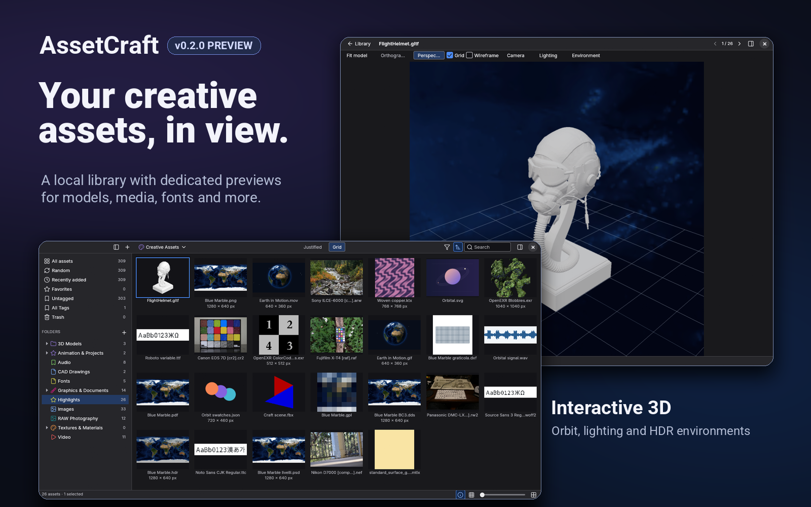
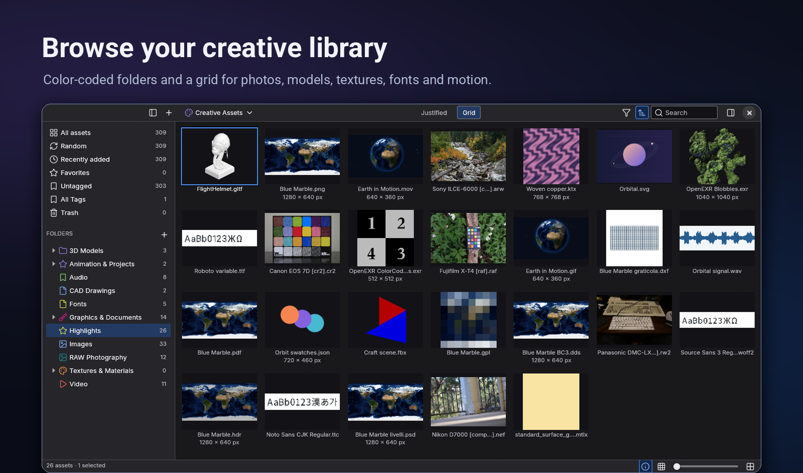
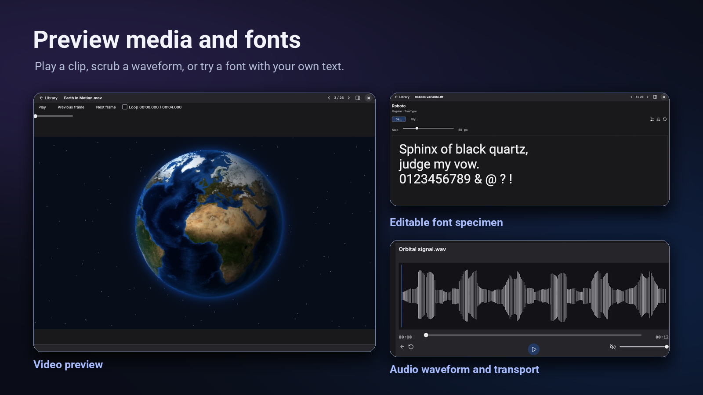

<p align="center">
  
</p>

<h1 align="center">AssetCraft</h1>

<p align="center">
  <strong>A local library for creative references.</strong><br>
  Browse, organize, and preview creative files where they already live.<br>
  An independent open-source app built with Rust and the Craft Framework.
</p>

<p align="center">
  <a href="https://github.com/Carbocode/AssetCraft/actions/workflows/ci.yml"></a>
  <a href="LICENSE"></a>
  
</p>

<p align="center">
  <a href="#features">Features</a> ·
  <a href="#screenshots">Screenshots</a> ·
  <a href="#get-started">Get started</a> ·
  <a href="#cli">CLI</a> ·
  <a href="#under-the-hood">Under the hood</a> ·
  <a href="#contributing">Contributing</a>
</p>

<p align="center">
  <a href="#screenshots"></a>
</p>

## Features

### Library and browsing

- **Keep originals in place.** Add files or drop them into a local SQLite library. The catalog stores references to the source files and keeps entries searchable if an original is offline.
- **Organize references.** Assign an asset to multiple nested folders, add multiple tags in one action, and record ratings, favorites, and notes. Move catalog entries to Trash and restore them when needed.
- **Browse folder trees in one view.** Open a parent folder to see its files and its descendants in ordered sections. Click a section to collapse or expand its branch, or hide all subfolders from the toolbar. Select a folder in the sidebar to leave the asset viewer and open that folder.
- **Find and compare assets.** Search by filename or tag, use file type and availability filters, and switch between grid and justified layouts. Zoom the thumbnails and toggle their captions. The inspector shows file properties and catalog metadata.

### Asset previews

| Assets | What you can preview |
| --- | --- |
| Raster and RAW | PNG, JPEG, WebP, GIF, TIFF, BMP, ICO, TGA, QOI, AVIF, HEIF, JPEG XL, and specialist rasters including supported Cineon and JPEG-LS variants. Camera RAW preview depends on what the file or decoder provides. |
| Images and animations | Zoom and pan images and add point comments. GIF and animated WebP have playback, seeking, looping, and frame stepping. |
| Vector, print, and layered files | SVG and the first PDF page. EPS supports embedded previews and supported ImageMagick RGB payloads. XCF can show an approximate composite of visible layers. PSD, PSB, ORA, KRA, and native Craft formats use composite or saved previews where available. |
| Audio | WAV, AIFF, FLAC, MP3, M4A, and Ogg/Opus with a themed waveform and a fixed playback bar. On Linux, play, pause, scrub, loop, mute, and adjust volume through the installed PipeWire client (`pw-cat`). Large PCM WAV files use range reads. |
| Video | Supported MP4, QuickTime, WebM, Matroska, AVI, MXF, and MPEG transport streams with playback, seeking, looping, and frame stepping. Craft decodes supported H.264, HEVC, AV1, VP8, VP9, ProRes, DNx, Motion JPEG, and MPEG-2 variants. Supported audio tracks use PipeWire on Linux. MP4 and QuickTime audio use packet range reads. Matroska and WebM audio playback is available for files up to 128 MiB. Older PipeWire clients use the system `stdbuf` command to report when the stream starts. |
| Fonts | Live antialiased outlines from TTF, OTF, TTC, WOFF, and WOFF2. Switch between the editable specimen and a character sample, adjust size, and choose collection faces, named styles, and variable axes where available. |
| 3D and CAD | Orbit, pan, and zoom supported GLB, glTF, OBJ, STL, PLY, 3MF, FBX, COLLADA, Alembic, and USD meshes. Switch between perspective and orthographic projection, toggle the grid or wireframe, and adjust the key light. Studio colors follow the theme. A 2:1 HDR or EXR panorama from the library can light the model and serve as its backdrop. Model previews use base colors and have transparent thumbnails. USD support covers complete local static meshes and basic transforms. CAD previews show visible model-space linework from DXF and supported DWG files. |
| Textures and materials | DDS, KTX, KTX2, and Basis Universal previews for supported encodings. Inspect texture dimensions and mip levels, view GIMP palette swatches, and inspect MaterialX graphs with a base-color swatch when a constant color is available. |
| Animation and design projects | First-frame previews of supported Lottie and dotLottie vector shapes, embedded Sketch previews, and metadata for After Effects projects. |

Preview support depends on the encoding, linked resources, and content inside each file. The current preview covers a subset of Lottie shapes, EPS payloads, and USD geometry. After Effects composition playback and full MaterialX shader rendering are outside the current preview coverage.

## Screenshots

These captures show the Linux desktop preview with a selection from the format test library. Open an image for a larger view.

| Creative library | Interactive 3D | Media and fonts |
| --- | --- | --- |
| [](docs/screenshots/creative-library.webp) | [](docs/screenshots/model-viewer.webp) | [](docs/screenshots/media-and-fonts.webp) |

[See the full preview gallery](docs/screenshots/README.md) · [Sample credits](ATTRIBUTION.md#preview-gallery)

## Get started

Pre-release archives are available for Linux x64, macOS Apple Silicon and Windows x64 on the [Releases page](https://github.com/Carbocode/AssetCraft/releases). Extract the archive and run `assetcraft-desktop` from the extracted directory (`assetcraft-desktop.exe` on Windows). The archives contain unsigned preview builds.

To build from source, install Rust 1.95 or newer and the platform C toolchain. On Linux, also install the native windowing libraries listed in the [Linux CI workflow](.github/workflows/ci.yml).

```sh
cargo run --locked --features desktop --bin assetcraft-desktop
```

Create or open a library, then use **Add files** or drop files into the workspace. Select a folder first to add imported assets to that folder. Double-click an asset to open its preview or use the inspector’s preview button. Use the sidebar to switch folders while a preview is open.

## CLI

The desktop and CLI share the same catalog.

```sh
cargo build --locked
target/debug/assetcraft-cli create ./catalog.sqlite "My library"
target/debug/assetcraft-cli add ./catalog.sqlite /path/to/logo.png /path/to/photo.jpg
target/debug/assetcraft-cli find ./catalog.sqlite logo
```

Create a catalog at an unused destination. The CLI uses the same format identification as the desktop. A batch reports rejected files individually and retains successful entries. Search matches a literal, case-sensitive substring in an asset's filename or tags. An empty query includes entries whose originals are unavailable.

## Under the hood

The Rust CLI and desktop share the SQLx catalog. The desktop uses the Craft Framework for the application shell, theme, dialogs, and shared browsing components. The current catalog schema is version 13. AssetCraft upgrades supported catalogs from versions 6 through 12 on open. The migration from older public formats preserves point-comment IDs and prevents their reuse after deletion.

In the image viewer, switch on **Add point comment** in the toolbar, click a point on the image, and write and save your comment in the popup. The tool stays active so you can annotate more points. Numbered bubbles follow the creation order on each image. Click a bubble to read, edit, or delete the comment, or drag it to move the anchor. The numbers close up after a deletion. From the CLI, `comment-add <catalog> <asset-id> <relative-x> <relative-y> <text>` adds a point comment, and `comments <catalog> <asset-id>` lists the saved comments. Use the ID returned by that list with `comment-edit`, `comment-move`, and `comment-delete`. Coordinates run from 0 to 1, starting from the top-left of the image.

## Contributing

Read the [repository guidance](AGENTS.md) for project conventions and [security policy](SECURITY.md) for reporting vulnerabilities. The CodeRabbit GitHub App reviews pull requests automatically, including drafts.

```sh
cargo fmt --all -- --check
cargo clippy --locked --features desktop --all-targets -- -D warnings
cargo test --locked --features desktop
```

### Release previews

Run **Release preview** from GitHub Actions to build archives for all three platforms without publishing. Pushing a version tag that matches `Cargo.toml`, such as `v0.2.0`, runs the same builds and publishes a GitHub pre-release with the three archives and `SHA256SUMS` after all builds pass.

## License

AssetCraft is licensed under [Apache-2.0](LICENSE). See [third-party attribution](ATTRIBUTION.md).
